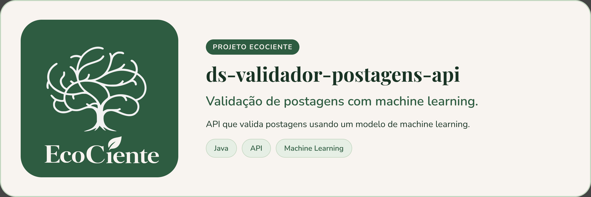

<p align="center">
  
</p>

# Validador de Postagens — EcoCiente


> API de validação das postagens de reciclagem do EcoCiente, em Java 21 e Spring Boot. Faz a triagem automática da foto com um modelo de visão (CLIP em ONNX Runtime, só CPU), registra os votos ponderados da comunidade e a decisão do síndico, e fecha a janela de validação de 24h, tudo sobre o PostgreSQL do app. A pontuação e o ranking ficam com a API de Pontuação, que lê `pontuacao_reconciliacao_pendente`.

A postagem precisa de condomínio: usuário comum (sem condomínio) não posta foto. A triagem é um sinal auxiliar; quem decide é a votação comunitária. As regras de voto, histerese (-5 / ≥ 0), fechamento e trust_score vivem nos procedures do banco; a API só os chama.

## Sobre o projeto

Este é o validador de postagens do **EcoCiente**, um sistema de reciclagem comunitária. A API valida fotos de resíduos que os moradores postam, utilizando um modelo de visão por computador (CLIP) para triagem automática e integrando votos da comunidade com decisões do síndico, tudo sobre PostgreSQL.

### Fluxo principal

1. **Triagem automática** (POST `/v1/postagens/{id}/triagem`): baixa a foto, roda o CLIP em ONNX Runtime (só CPU), grava confiança e veredito
2. **Votos comunitários** (POST `/v1/postagens/{id}/votos`): usuarios votam; rejeições com denúncia requerem motivo
3. **Decisão do síndico** (POST `/v1/postagens/{id}/decisao`): síndico confirma ou reverte em análise
4. **Job de fechamento**: encerra janela de 24h, recalcula trust_score

## Ajustes e melhorias

O projeto ainda está em desenvolvimento e as próximas atualizações serão voltadas para as seguintes tarefas:

- [x] Triagem automática com CLIP gravando `triagem_automatica_aprovada` / `triagem_automatica_confianca`
- [x] Votos ponderados (1 / 3 / 3) com bloqueio de autovoto
- [x] Decisão do síndico para postagens em análise
- [x] Fechamento da janela de 24h (job agendado na própria API) e recálculo do trust_score
- [x] Migração de Python para Java 21 + Spring Boot, com o mesmo contrato HTTP
- [x] Dockerfile com os modelos embutidos na imagem
- [x] DHash conferido contra o algoritmo do Pillow (hashes gravados continuam comparáveis)
- [ ] Rodar a imagem Docker e o teste de integração com PostgreSQL (`./gradlew testeBanco`, precisa de Docker)
- [ ] Calibrar o limiar com fotos reais (`./gradlew calibrar`)
- [ ] Suporte a HEIC (fotos de iPhone): o Java não decodifica HEIC hoje
- [ ] Rebaixar "pessoa confiável" com histórico ruim (`sp_atualizar_trust_score` hoje só promove — ajuste no SQL)

## Pré-requisitos

Antes de começar, verifique se você atendeu aos seguintes requisitos:

- **JDK 21** para rodar o Gradle wrapper (versões 17–24 aceitáveis) — o Gradle 8.14 baixa sozinho na 1ª compilação e requer internet
- **Docker** para os testes de integração (PostgreSQL via Testcontainers) e para a imagem de produção
- **CLIP ONNX Runtime**: três arquivos em `CLIP_DIR` (padrão: `modelos/clip-vit-base-patch32`) — ver [Modelo de visão](#modelo-de-visão-clip)
- **PostgreSQL** do app com schema EcoCiente e lookups carregados (fornecidos em `src/test/resources/sql/`)
- Funciona em Windows, Linux e macOS (só CPU, sem GPU)

## Instalando

### Linux / macOS

```bash
git clone https://github.com/EcoCiente-Instituto-J-F/ds-validador-postagens-api.git
cd ds-validador-postagens-api
cp .env.example .env
./gradlew build
```

### Windows (PowerShell ou Prompt de Comando)

```bat
git clone https://github.com/EcoCiente-Instituto-J-F/ds-validador-postagens-api.git
cd ds-validador-postagens-api
copy .env.example .env
gradlew.bat build
```

### Modelo de visão (CLIP)

A API precisa de três arquivos do CLIP ViT-B/32 em ONNX, na pasta indicada por `CLIP_DIR` (padrão `modelos/clip-vit-base-patch32`):

| Arquivo | Tamanho | Origem |
|---|---|---|
| `vision_model.onnx` | 352 MB | [Xenova/clip-vit-base-patch32](https://huggingface.co/Xenova/clip-vit-base-patch32/tree/main/onnx) |
| `text_model.onnx` | 254 MB | idem |
| `tokenizer.json` | 2,2 MB | [Xenova/clip-vit-base-patch32](https://huggingface.co/Xenova/clip-vit-base-patch32/tree/main) |

Baixe-os com:

```bash
mkdir -p modelos/clip-vit-base-patch32 && cd modelos/clip-vit-base-patch32
B=https://huggingface.co/Xenova/clip-vit-base-patch32/resolve/main
curl -fL -o vision_model.onnx "$B/onnx/vision_model.onnx"
curl -fL -o text_model.onnx "$B/onnx/text_model.onnx"
curl -fL -o tokenizer.json "$B/tokenizer.json"
```

Confira os tamanhos: um arquivo truncado carrega até o meio e falha só na primeira foto.

## Usando

### Subir a API

```bash
./gradlew bootRun
```

A 1ª subida carrega o CLIP na memória (alguns segundos). Documentação interativa: <http://localhost:8000/docs>

### Testes

```bash
./gradlew test                  # unitários, sem modelo nem banco (rápido)
./gradlew testeModelo           # carrega o CLIP de verdade (requer CLIP_DIR)
./gradlew testeBanco            # integração com PostgreSQL via Testcontainers (requer Docker)
./gradlew build                 # todos, excluindo modelo e banco
```

O teste `testeBanco` aplica o schema inteiro num container PostgreSQL descartável; nunca toca o banco do app.

### Calibração do limiar

Com fotos reais em `amostras/<categoria>/` e `amostras/nao_residuo/`:

```bash
./gradlew calibrar -PpastaAmostras=amostras
```

Use em `LIMIAR_CONFIANCA` o menor limiar com `aprovaria_errada` ≤ 5%.

## Estrutura do projeto

```text
src/main/java/br/com/ecociente/validador/
  core/          Domínio puro: records, enums, services
  dataprovider/  Adaptadores: gateway (JDBC), foto (download), visão (CLIP)
  entrypoint/    Controller, DTO, HTTP exceptions, Prometheus metrics
  config/        Propriedades, segurança (X-Api-Key), inicialização CLIP, job agendado
  calibracao/    Ferramenta CLI para calibração de limiares

src/test/        Testes espelhando a estrutura; tags "modelo" e "banco" excluídas por padrão
```

## Contrato HTTP

Todas as rotas de serviço exigem o header `X-Api-Key`. Corpos e respostas em snake_case. Chamadas do backend do app apenas.

### POST `/v1/postagens/{id}/triagem`

Sem corpo. Lê `url_foto` e categoria da postagem, baixa a foto, roda o CLIP, grava `triagem_automatica_aprovada` e `triagem_automatica_confianca`.

**Resposta** (200):

```json
{
  "status": "ok",
  "pertinente": false,
  "categoria_informada": "plastico",
  "categoria_detectada": "vidro",
  "confianca": 87.42,
  "hash_foto": "f0e4c2a1b3d59687",
  "alternativas": [
    {"categoria": "plastico", "confianca": 9.1},
    {"categoria": "metal", "confianca": 2.0}
  ],
  "mensagem": "A foto parece conter vidro, não plástico."
}
```

**Status HTTP**:
- 200: triagem feita (arquivo não-imagem retorna `pertinente: false`)
- 401: `X-Api-Key` inválida ou ausente
- 422: host fora de `HOSTS_PERMITIDOS`, categoria inválida, etc.
- 502: falha no storage
- 503: fila cheia ou banco indisponível

### POST `/v1/postagens/{id}/votos`

Corpo: `{"usuario_id": 7, "tipo": "aprovar", "motivo_denuncia_id": null, "comentario": null}`

`tipo` é `aprovar` ou `denunciar` (denúncia requer `motivo_denuncia_id`). Chama `sp_processar_voto_postagem`.

**Resposta** (200): `{"saldo_confianca": 3, "pontuacao_ativa": true}`

### POST `/v1/postagens/{id}/decisao`

Corpo: `{"usuario_id": 1, "aprovar": true}`. Apenas o síndico do condomínio.

**Resposta** (204).

## Variáveis de ambiente

| Variável | Padrão | Descrição |
|---|---|---|
| `CHAVE_API` | obrigatória | Valor esperado no header `X-Api-Key` (≥16 caracteres) |
| `DB_URL` | obrigatória | JDBC PostgreSQL (`jdbc:postgresql://host:5432/banco`) |
| `DB_USER` / `DB_PASSWORD` | obrigatórias | Credenciais do banco |
| `HOSTS_PERMITIDOS` | obrigatória | Hosts de storage das fotos (CSV, anti-SSRF) |
| `CLIP_DIR` | `modelos/clip-vit-base-patch32` | Pasta com `vision_model.onnx`, `text_model.onnx`, `tokenizer.json` |
| `LIMIAR_CONFIANCA` | `0.5` | Probabilidade mínima para aprovar |
| `LIMIAR_REVISAO` | (desligado) | Zona de revisão humana (ex.: `0.3`) |
| `LIMIARES_POR_CATEGORIA` | (vazio) | JSON com limiares por categoria (ex.: `{"vidro": 0.6}`) |
| `MAX_PEDIDOS_SIMULTANEOS` | `8` | Triagens em andamento antes de responder 503 |
| `TAMANHO_MAXIMO_BYTES` | `10000000` | Tamanho máximo da foto (10 MB) |
| `TIMEOUT_DOWNLOAD_SEGUNDOS` | `10` | Timeout do download no storage |
| `FECHAMENTO_HABILITADO` | `true` | Liga o job de fechamento de 24h |
| `SERVER_PORT` | `8000` | Porta HTTP |
| `CHAVE_API_ANTERIOR` | (desligada) | Chave antiga aceita durante rotação |

> **Migração do Python**: substitua `URL_BANCO` por `DB_URL`/`DB_USER`/`DB_PASSWORD`; `MODELO_CLIP` por `CLIP_DIR`.

## Deploy (k3s)

```bash
docker build -t ecociente-validador-fotos .
```

**Características**:
- Arquivos CLIP embutidos na imagem (baixados no build) → pod sobe sem internet
- Só CPU; readiness/liveness em `GET /saude`
- 1 réplica (job de fechamento roda dentro da API, carrega modelo inteiro na RAM)
- JVM usa até 75% da memória do contêiner (`JAVA_TOOL_OPTIONS`)
- `CHAVE_API` e `DB_*` em Secret `validador-fotos`; gere a chave: `openssl rand -base64 32`
- Service `ClusterIP` (apenas serviços internos chamam)

## Observabilidade

- **`GET /metrics`** (Prometheus, sem chave; exponha só dentro do cluster): métricas `validacoes_total{categoria,status,pertinente}`, `validacao_segundos`, `confianca_modelo{categoria}`, `pedidos_rejeitados_total`
- **Logs**: cada veredito sai como uma linha JSON com `id_postagem` (URL não aparece)
- **Rotação de chave**: suba `CHAVE_API` nova + `CHAVE_API_ANTERIOR` antiga, atualize chamadores, remova anterior

## Contribuindo

Leia o [CONTRIBUTING.md](CONTRIBUTING.md) e respeite o [Código de Conduta](CODE_OF_CONDUCT.md).

Para reportar uma vulnerabilidade de segurança, **não abra issue pública** — siga o [SECURITY.md](SECURITY.md).

## Licença

Esse projeto está sob licença MIT. Veja o arquivo [LICENSE](LICENSE) para mais detalhes.
